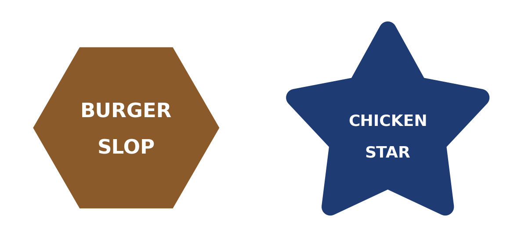
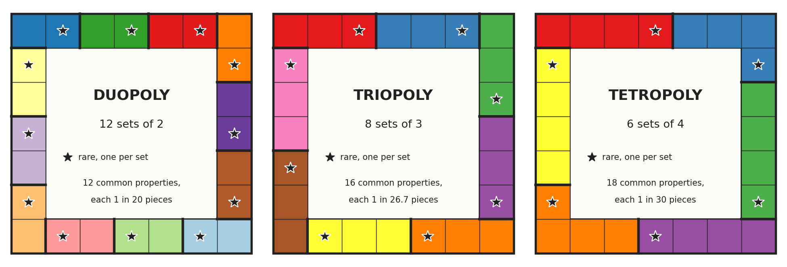
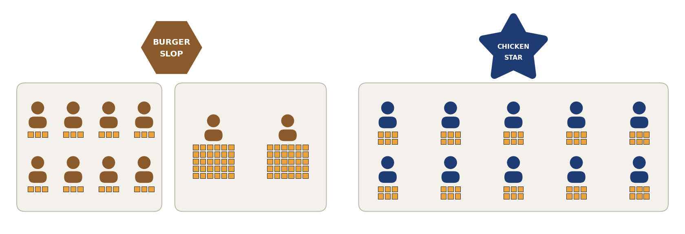

Title: Baby Mac Crypto
Date: 2026-11-05 11:00
Category: Mathematics
Tags: probability, coupon collector, size bias, inclusion exclusion, format preserving encryption, insurance

The fictional Acme Insurance Corp employs a team of recreational
mathematicians, people who study the fun parts of math (game theory,
combinatorics, and cryptography), and puts them to work as actuaries. They take
the most entertaining problems in mathematics and turn them into dry,
boring actuarial tables.

This week, two fast food chains want Acme to insure the prizes in
their collect-the-set contests. Burger Slop and Chicken Star will each
print ten million game pieces, and almost none of them will win
anything big. When a customer completes a set, Acme pays the prize.
Each chain is choosing among three versions of its game, so Acme needs
to know how much it should expect to pay out for each version, and
which version it would rather insure.

Throughout, we assume that no prize is ever stolen. The theft section
near the end asks what happens when that assumption fails.

The problem is small enough to solve on paper, and solving it turns
up three nuggets:

1. Collecting a set is a coupon collector problem where one coupon is
   tens of thousands of times rarer than the others.
2. The player holding a rare piece is not a typical player, because a
   player with more pieces is more likely to hold it. Treating them as
   typical can underprice a game by a factor of about three.
3. All the information needed to check a code is contained in the code
   itself.

## The Contests

Burger Slop's and Chicken Star's games work the same way. Each game
piece shows one property on a game board, printed in its set's color,
and a 14-character code. The properties are grouped into sets, and a
player who holds a piece of every property in a set wins that set's
prize by entering the pieces' codes online. Each code counts once, for
the first player to enter it. Each set has one rare property and some
common ones. "Common" here means plentiful: each common property is
printed hundreds of thousands of times, while only as many pieces
carry the rare property as the set has prizes.

All three versions of the game use a board of 24 properties, split
into sets of $k$ properties: one rare and $k-1$ common.

| game | $k$ | sets |
|---|---|---|
| duopoly | 2 | 12 |
| triopoly | 3 | 8 |
| tetropoly | 4 | 6 |

Each chain prints $N = 10^7$ pieces. Each prize is one rare piece:
200 prizes of &#36;1,000, 20 of &#36;25,000 and one grand prize of
&#36;1,000,000, for &#36;1.7 million in all. Common pieces make up 60%
of the pieces, and the rest carry no property.

The board's 24 properties make $24/k$ sets, each with $k-1$ common
properties: 12 common properties in duopoly (12 sets of 1), 16 in
triopoly (8 sets of 2) and 18 in tetropoly (6 sets of 3). They split
the 60% equally, so each common property has frequency

$$
p = \frac{0.6}{(24/k)(k-1)}
$$

which is 1 in 20 for duopoly, 1 in 26.7 for triopoly and 1 in 30 for
tetropoly.

The contests run six weeks, and half the pieces go to people who never
enter a code. The rest go to players, and here the chains differ. At
Burger Slop, 80% of players buy little and collect 3 pieces over the
contest, and the other 20%, the heavy players, buy a lot and collect
30. At Chicken Star, every player collects one piece a week, so 6 over
the six-week contest. That makes about 600,000 players
at Burger Slop and 830,000 at Chicken Star. Each piece is an
independent random draw from the printed pieces, players do not
trade, and finding a rare piece does not change how many more pieces a
player collects.

## A Skewed Coupon Collector

In the classical coupon collector problem, each draw is uniform over
$k$ coupons, and collecting all $k$ takes $k H_k$ draws on average,
where $H_k = 1 + \tfrac{1}{2} + \cdots + \tfrac{1}{k}$ is the $k$-th
harmonic number, which grows like $\ln k$. These coupons are about as
far from uniform as coupons get.

Model each piece a player receives as an independent draw from the
$N$ printed pieces. A set $S$ has one rare piece and $k-1$ common
pieces. Let $m_S$ be the number of prizes for $S$. The rare piece is
printed $m_S$ times, so a draw is the rare piece with probability

$$
\epsilon_S = \frac{m_S}{N}
$$

There are 221 prizes in all. Even a set that held every one of them
would have $\epsilon_S = 221/10^7$, so its rare piece would turn up
once in $10^7/221 = 45{,}249$ draws on average. A real set has fewer
prizes, so its rare piece is scarcer and the wait is longer. This is
the same in every game, because it depends only on how often the rare
piece is printed.

Let $T_S$ be the number of draws until a player holds all $k$ pieces
of $S$, $T_R$ the number until the rare piece, and $T_C$ the number
until all $k-1$ common pieces. A player holds the set once they hold
both, so $T_S = \max(T_R, T_C)$ and $T_R \le T_S \le T_R + T_C$.
Averaging,

$$
\frac{1}{\epsilon_S} \le E[T_S] \le \frac{1}{\epsilon_S} + E[T_C]
$$

The last term is the average wait for the common pieces, and this is
where the games differ:

* **Duopoly:** one common piece per set, turning up 1 draw in 20. It
  takes 20 draws on average.
* **Triopoly:** two common pieces, each 1 in 26.7. Either one will do
  for the first, so the first turns up twice as fast, after
  $26.7/2 = 13.3$ draws. The second takes another 26.7, for 40 in all.
* **Tetropoly:** three common pieces, each 1 in 30. The first takes
  $30/3 = 10$ draws, the second another $30/2 = 15$, and the last
  another 30, for 55 in all.

Each total is $E[T_C] = H_{k-1} \times (1/p)$, where $1/p$ is the wait
for one particular common piece: $1 \times 20 = 20$,
$1.5 \times 26.7 = 40$ and $1.83 \times 30 = 55$. So the common pieces
add 20 to 55 draws to a wait of at least 45,249 for the rare piece.
The rare piece's wait is more than 800 times longer, in every game.
The 20 to 55 draws are an upper limit, because players collect the
common pieces while they wait for the rare one and almost always have
them all by the time it shows up.

So the wait for any set is at least 45,249 draws, and all of it is
spent waiting for the rare piece. No player waits that long, though:
players collect 3 to 30 pieces. What the rest of the post uses is the
same fact for a fixed number of draws. Draws are independent, so
finding the rare piece says nothing about a player's other pieces, and
the player completes the set exactly when those include every common
property.

## One Number

A prize is paid only if its rare piece is redeemed, so everything the
actuary needs comes down to one number: $q$, the probability that a
given rare piece is redeemed. That takes two things. The piece has to
go to a player, which happens with probability 1/2. And that player's
other pieces have to include all $k-1$ common properties of its set.

### Size Bias

In the figure, each person is 10% of a chain's players and each square
is one game piece over the six-week contest.

The naive move is to take a typical Burger Slop player and ask how
often their other pieces complete the set. But the rare piece does not
go to a typical player. Every piece is equally likely to be the rare
one, so a player with 30 pieces is ten times as likely to hold it as a
player with 3. This is the inspection paradox.

Let $X$ be the number of pieces a random player collects, so
$\Pr(X = n)$ is the fraction of players who collect $n$ pieces. At
Burger Slop, $\Pr(X = 3) = 0.8$ and $\Pr(X = 30) = 0.2$. At Chicken
Star, $\Pr(X = 6) = 1$. Weighting each player by their number of
pieces, the holder of a rare piece received $n$ pieces with
probability

$$
\frac{n \Pr(X = n)}{E[X]}
$$

The factor $n$ is the weighting, and dividing by $E[X]$, the average
number of pieces per player, makes the probabilities add up to 1. How much this changes the answer
depends on how unevenly the pieces are spread among a chain's players,
and the two chains are opposites.

At Burger Slop the spread is wide. The average player collects

$$
E[X] = 0.8 \cdot 3 + 0.2 \cdot 30 = 8.4
$$

pieces, and the holder of a rare piece is a heavy player with
probability $0.2 \cdot 30 / 8.4 = 0.714$. Heavy players are 20% of
players but hold 71% of the rare pieces. Averaging $n$ with these
weights, the holder of a rare piece has $E[X^2]/E[X] = 22.3$ pieces,
against 8.4 for a typical player.

At Chicken Star there is no spread. Every player collects 6 pieces, so
$E[X] = 6$, and the holder received 6 pieces with probability
$6 \cdot 1 / 6 = 1$. The holder of a rare piece is a typical player,
and the naive answer is exact.

### Collecting the Commons

The holder of a rare piece wins only if their other pieces include
every common property of its set. Write $P_k(r)$ for the chance that
$r$ draws include all $k-1$ common properties of a set, each of
frequency $p$.

In duopoly there is one common property. A draw misses it with
probability $1-p$, so $r$ draws all miss it with probability
$(1-p)^r$, and

$$
P_2(r) = 1 - (1-p)^r
$$

With two or more common properties, subtracting the chance of missing
each one subtracts too much: draws that miss two properties at once
get subtracted twice. Inclusion-exclusion, the same tool as in
[Enumeration Solitaire](enumeration-solitaire-derangements-with-four-copies-of-each-rank.html),
adds those back, then corrects for draws that miss three, and so on.
A run of $r$ draws misses a given group of $a$ properties with
probability $(1-ap)^r$, so for triopoly and tetropoly

$$
P_3(r) = 1 - 2(1-p)^r + (1-2p)^r
$$

$$
P_4(r) = 1 - 3(1-p)^r + 3(1-2p)^r - (1-3p)^r
$$

Putting the pieces together gives the one number. A rare piece reaches
a player with probability 1/2, its holder collected $n$ pieces with
the size-bias weight $n \Pr(X = n) / E[X]$, and the holder's other
$n - 1$ pieces include every common property with probability
$P_k(n-1)$. Summing over $n$ gives

$$
q = \frac{1}{2} \, \frac{E\left[ X \, P_k(X-1) \right]}{E[X]}
$$

Now put in Burger Slop's numbers. A heavy player collects 30 pieces, so a
heavy player holding a rare piece has 29 others. They include the
commons the player needs with probability $P_k(29)$: 0.77 in duopoly,
0.44 in triopoly and 0.24 in tetropoly. A light player collects 3 pieces,
so a light player holding a rare piece has only 2 others. They include
the commons with probability $P_k(2)$: 0.10 in duopoly, under 0.003 in
triopoly, and never in tetropoly, which needs three.

With the weights 0.286 and 0.714 from the size bias section, the
formula for Burger Slop is

$$
q = \tfrac{1}{2} \left( 0.286 \, P_k(2) + 0.714 \, P_k(29) \right)
$$

| game | $q$ | $q$ without size bias | $q$ simulated |
|---|---|---|---|
| duopoly | 0.290 | 0.116 | 0.293 ± 0.004 |
| triopoly | 0.159 | 0.046 | 0.156 ± 0.004 |
| tetropoly | 0.084 | 0.024 | 0.082 ± 0.003 |

The middle column uses a typical player's weights, 0.8 and 0.2, in
place of 0.286 and 0.714. The simulation deals pieces to players and
counts the rare pieces that end up in completed sets. It
agrees with the formula, and not with the middle column. Ignoring size
bias underprices every Burger Slop game by a factor of 2.5 to 3.5.

Bigger sets lower $q$ twice over: the holder must find more common
properties, and each is scarcer, because more of them share the same
60% of the pieces.

### Chicken Star

At Chicken Star the holder of a rare piece has 5 other pieces, so

$$
q = \tfrac{1}{2} P_k(5)
$$

| game | Burger Slop | Chicken Star |
|---|---|---|
| duopoly | 0.290 | 0.113 |
| triopoly | 0.159 | 0.013 |
| tetropoly | 0.084 | 0.001 |

Chicken Star's $q$ is lower in every game, and far lower in the bigger
ones: with 5 other pieces, a holder rarely finds all three common
properties of a tetropoly set.

### Contest Length

The formula for $q$ never mentions how long the contest runs. A set
counts if its holder has every piece by the end, so what matters is
how many pieces a player collects, not when they collect them.

At Burger Slop, say light players
collect 0.5 pieces a week and heavy players 5. Over $w$ weeks they
collect $0.5w$ and $5w$ pieces, whole numbers for contests of 4, 6 and
8 weeks, and

$$
q = \tfrac{1}{2} \left( 0.286 \, P_k(0.5w - 1) + 0.714 \, P_k(5w - 1) \right)
$$

The weights are still 0.286 and 0.714, because both rates scale with
$w$. At six weeks this is the $q$ from before, with 3 and 30 pieces.

Whether the length cancels out depends on how the chain prints. If it
prints a fixed run of $N$ pieces and runs the contest until they are
gone, it does: $N$ and the number of customers set the pieces per
player, and $w$ drops out. If it prints for the length of the contest,
it does not: at the same buying rates, players collect more pieces in
a longer contest, with the same 221 prizes.

Here is Burger Slop's $q$ at four, six and eight weeks:

| game | 4 weeks | 6 weeks | 8 weeks | ratio, 8 to 4 |
|---|---|---|---|---|
| duopoly | 0.230 | 0.290 | 0.329 | 1.4 |
| triopoly | 0.093 | 0.159 | 0.214 | 2.3 |
| tetropoly | 0.035 | 0.084 | 0.138 | 3.9 |

Stretching the contest from four weeks to eight multiplies duopoly's
$q$ by 1.4 and tetropoly's by 3.9.

At Chicken Star every player collects one piece a week, so over a
contest of $w$ weeks each player collects exactly $w$ pieces, and

$$
q = \tfrac{1}{2} P_k(w - 1)
$$

| game | 4 weeks | 6 weeks | 8 weeks | ratio, 8 to 4 |
|---|---|---|---|---|
| duopoly | 0.071 | 0.113 | 0.151 | 2.1 |
| triopoly | 0.004 | 0.013 | 0.024 | 6.0 |
| tetropoly | 0.0001 | 0.0010 | 0.0032 | 29 |

Chicken Star's $q$ is far more sensitive to the length than Burger
Slop's. Its players hold too few pieces to finish a big set, so each
extra week raises their chances by a large factor: from four weeks to
eight, tetropoly's $q$ grows 29-fold.

## Expected Payout

If Acme Insurance Corp takes on a contest, it pays every prize that is
won. Each prize is won with probability $q$, so the prize money Acme
expects to pay out is $q$ times the &#36;1.7 million at stake. The
premium Acme would charge the chain starts from this expected payout
and adds a margin for overhead and profit; this post stops at the
expected payout.

Because $q$ depends on how long the contest runs, so does the expected
payout. Here it is for contests of four, six and eight weeks.

At Burger Slop:

| game | $q$, 4 weeks | payout, 4 weeks | $q$, 6 weeks | payout, 6 weeks | $q$, 8 weeks | payout, 8 weeks |
|---|---|---|---|---|---|---|
| duopoly | 0.230 | &#36;390k | 0.290 | &#36;494k | 0.329 | &#36;560k |
| triopoly | 0.093 | &#36;158k | 0.159 | &#36;270k | 0.214 | &#36;365k |
| tetropoly | 0.035 | &#36;60k | 0.084 | &#36;143k | 0.138 | &#36;235k |

At Chicken Star:

| game | $q$, 4 weeks | payout, 4 weeks | $q$, 6 weeks | payout, 6 weeks | $q$, 8 weeks | payout, 8 weeks |
|---|---|---|---|---|---|---|
| duopoly | 0.071 | &#36;121k | 0.113 | &#36;192k | 0.151 | &#36;256k |
| triopoly | 0.004 | &#36;6.9k | 0.013 | &#36;21k | 0.024 | &#36;42k |
| tetropoly | 0.0001 | &#36;190 | 0.0010 | &#36;1.7k | 0.0032 | &#36;5.4k |

The expected payout holds only for a contest of a stated length, so
Acme's policy should state the length.

The expected payout is not what Acme will actually pay. Two rare
pieces almost never share a holder, so the prizes are paid nearly
independently, and the grand prize is most of the money. The payout is
mostly one coin flip.

At Burger Slop, the 220 smaller prizes are expected to cost &#36;203k
in duopoly. So duopoly pays about &#36;203k with probability 0.71, and
about &#36;1.2M with probability 0.29, when the grand prize is won too.
Tetropoly's smaller prizes are expected to cost &#36;59k, so it pays
about &#36;59k with probability 0.916 and about &#36;1.06M with
probability 0.084. Chicken Star's tetropoly pays the grand prize with
probability 0.001, and its smaller prizes are expected to cost
&#36;700 in all.

## Sensitivity

Every $q$ above rests on a guess about how many pieces players collect.
What matters to Acme is how far a wrong guess would leave its expected
payout too low. So that the guesses can be compared, each one is moved
by the same amount, a third.

At Burger Slop the main guess is the figure of 30 pieces per heavy
player. Here is $q$ if the true figure is a third lower or higher:

| game | $q$ at 20 | $q$ at 30 | $q$ at 40 | ratio, 40 to 20 |
|---|---|---|---|---|
| duopoly | 0.213 | 0.290 | 0.344 | 1.6 |
| triopoly | 0.082 | 0.159 | 0.230 | 2.8 |
| tetropoly | 0.031 | 0.084 | 0.149 | 4.8 |

Bigger sets are more sensitive. Let $\lambda = pr$, the expected number
of copies of one common property in $r$ draws. Replacing each
$(1-ap)^r$ in $P_k(r)$ by $e^{-a\lambda}$ gives
$P_k(r) \approx (1 - e^{-\lambda})^{k-1}$, so a 1% error in $r$ moves
$P_k$ by about

$$
(k-1) \, \frac{\lambda e^{-\lambda}}{1 - e^{-\lambda}}
$$

percent. The fraction falls from 1 toward 0 as $\lambda$ grows, since
extra draws help less once a player probably holds each common
property, and the factor $k-1$ counts the common properties that must
all turn up. For a heavy player's 29 other pieces this is 0.44% in
duopoly, 1.1% in triopoly and 1.8% in tetropoly.

In dollars, here is how much each expected payout would be too low if
a guess is a third too low. A third more pieces for every player is the
eight-week contest from the contest length section.

| a third too low | chain | duopoly | triopoly | tetropoly |
|---|---|---|---|---|
| heavy players' pieces (40, not 30) | Burger Slop | &#36;91k | &#36;121k | &#36;110k |
| every player's pieces (eight weeks, not six) | Burger Slop | &#36;66k | &#36;94k | &#36;92k |
| every player's pieces (8, not 6) | Chicken Star | &#36;64k | &#36;20k | &#36;3.7k |

## Actuary Recommendation

Acme prefers the game whose expected payout is off by the fewest
dollars when a guess about the players is a third too low. The coin
flip does not enter: across the many contests Acme insures, the flips
average out, but a wrong guess about players is wrong in every contest
priced with it.

With no theft, insure duopoly at Burger Slop and tetropoly at Chicken
Star.

At Burger Slop, tetropoly has the lowest expected payout, &#36;143k
against duopoly's &#36;494k, but the heavy players make the bigger
games' prices hard to pin down. If players collect a third more pieces
than guessed, Acme's expected payout for duopoly is too low by
&#36;66k to &#36;91k, and for the bigger games by &#36;92k to
&#36;121k. Duopoly costs the most, and its cost is known best.

At Chicken Star, with 6 pieces each, almost nobody completes a
tetropoly set. Its expected payout is &#36;1,700, and 8 pieces per
player would add &#36;3,700 to it. Tetropoly is both the cheapest game and the one
whose cost is known best.

## Codes That Check Themselves

Strip away the paper and the contest is codes and an oracle: each
piece's 14-character code is a token, and the server is an oracle that
says whether a code is valid and what it wins. Forgery means making up
a valid code. Theft means taking one that already exists. Acme insures
a contest only if the chain uses Acme's codes, which make forgery
hopeless and can be checked without a stored list of valid codes.

A code is 14 characters over 32 symbols (A-Z and 0-9, minus the
look-alikes 0, O, 1 and I), so it is a 70-bit number, an element of
$D = \{0, 1, \dots, 2^{70}-1\}$.

The chain's market is split into 100 zones of equal population. Zone
$z$ gets $N_z = 10^5$ pieces, and its piece $i$, for
$i = 0, 1, \dots, N_z - 1$, gets the index $j = z N_z + i$, so the
indices run from 0 to $N - 1$. A small table per zone says which
property each $i$ carries, with the zone's rare pieces at the lowest
$i$.

Acme holds one secret key, and $\pi$ is a published format-preserving
cipher on $D$ under that key: a permutation of $D$ that looks random
to anyone without the key. Format-preserving means it turns a 70-bit
number into another 70-bit number, so the result still fits in 14
characters. Piece $j$ gets the code $\pi(j)$.

To check a code $y$, the server decrypts it to $j = \pi^{-1}(y)$. If
$j < N$, the code is piece $i = j - z N_z$ of zone
$z = \lfloor j / N_z \rfloor$; the server reads its property from that
zone's table and marks $j$ as redeemed. Otherwise the code is
rejected.

**Forgery.** Without the key, a guessed code decrypts to an
essentially uniform element of $D$. It passes as a printed piece with
probability

$$
\frac{N}{2^{70}} \approx 8.5 \times 10^{-15}
$$

and as a rare piece with probability
$221 / 2^{70} \approx 1.9 \times 10^{-19}$. The index uses
$\log_2 N \approx 23.3$ of the code's 70 bits, and the other 46.7 bits
act as an authentication tag. Forgery is not worth pricing.

The codes do nothing against theft, which the theft section takes up.

## Theft

Every expected payout above assumes nobody steals a prize. A thief
always redeems what they steal, so for a stolen piece $q$ becomes 1,
as it does for a holder who keeps buying until they have the commons.
A stolen grand prize costs the full &#36;1 million instead of $q$
times &#36;1 million, so it adds $(1 - q)$ times &#36;1 million to the
expected payout:

| game | Burger Slop | Chicken Star |
|---|---|---|
| duopoly | &#36;710k | &#36;887k |
| triopoly | &#36;841k | &#36;987k |
| tetropoly | &#36;916k | &#36;999k |

Duopoly's expected payout misses by the least. At Burger Slop this
agrees with the answer without theft. At Chicken Star, let $\theta$ be
the probability that the grand prize is stolen. With 8 pieces per
player, not 6, duopoly's expected payout is too low by
&#36;64k + $\theta$ × &#36;887k and tetropoly's by
&#36;3.7k + $\theta$ × &#36;999k, so duopoly is the better game once
$\theta$ is above 0.54.

The codes cannot prevent a theft; they only stop forgery. Preventing
theft takes physical and digital security: chain of custody for the
printed pieces, and protection for the oracle and its key, since a
leaked key exposes every rare code. After a theft, the zone a code decrypts to can
flag a suspicious claim, such as a rare code from one zone redeemed
with common codes from another.

## Summary

When one coupon is tens of thousands of times rarer than the rest, the
expected wait for the whole set is the wait for that coupon, and
holding the others does not make it any likelier to turn up.

The holder of a rare piece is not a typical player, because choosing a
person through something they hold weights each person by how much
they hold. This is the inspection paradox. At Burger Slop it is worth a
factor of about three in price. At Chicken Star, where every player
holds the same number of pieces, it is worth nothing.

Encrypting the piece index with a format-preserving cipher makes each
code its own proof of validity. The server keeps one key and small tables
instead of a list of $10^7$ codes, and the spare bits of the code bound
the forgery rate.

## Code

<https://git.charlesreid1.com/charlesreid1/baby-mac-crypto/src/branch/main/calculations.py>

## References

* Related: [Baby Poker](baby-poker-the-smallest-interesting-bluffing-game.html)
  and
  [Enumeration Solitaire](enumeration-solitaire-derangements-with-four-copies-of-each-rank.html),
  two other small problems with complete solutions
* P. Flajolet, D. Gardy and L. Thimonier,
  [Birthday paradox, coupon collectors, caching algorithms and self-organizing search](https://doi.org/10.1016/0166-218X%2892%2990177-C),
  *Discrete Applied Mathematics* 39 (1992), 207–229: the coupon
  collector with unequal probabilities
* M. Dworkin,
  [Recommendation for Block Cipher Modes of Operation: Methods for Format-Preserving Encryption](https://doi.org/10.6028/NIST.SP.800-38G),
  NIST SP 800-38G (2016): the FF1 format-preserving cipher
